<p align="center">
  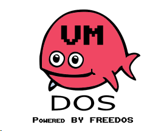
</p>

<h1 align="center">vmdos</h1>

<p align="center">
  <b>Boot straight into DOS on a modern PC, at full speed, with today's hardware working.</b><br>
  A tiny bare-metal hypervisor that makes FreeDOS (or MS-DOS) believe it owns a 1990s PC,<br>
  while it actually runs on your UEFI laptop's USB 3, NVMe, HD Audio and gigabit Ethernet.
</p>

<p align="center">
  <a href="https://github.com/jasonbrianhall/vmdos/releases"><b>⬇ Download the USB image</b></a> ·
  <a href="#quick-start">Quick start</a> ·
  <a href="#screenshots">Screenshots</a> ·
  <a href="TECHNICAL.md">Technical reference</a>
</p>

---

<p align="center">
  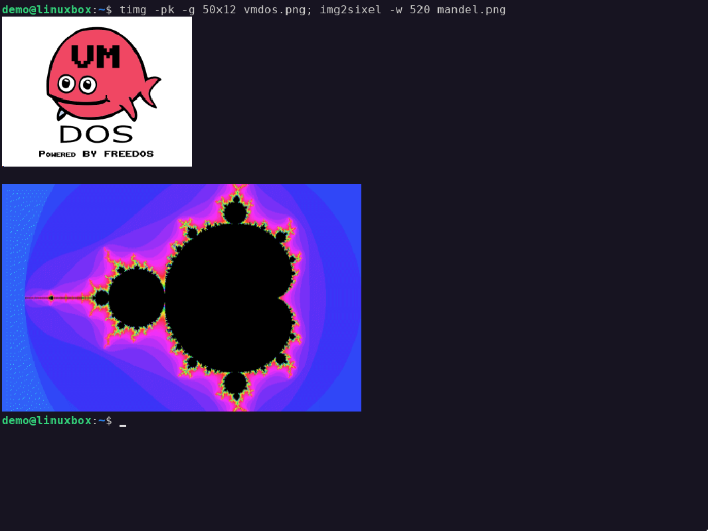<br>
  <sub>Yes, that's DOS. Felix Terminal over SSH to a Linux box, drawing kitty and sixel graphics.</sub>
</p>

## Why vmdos?

DOS on a modern PC is usually painful. There's no Sound Blaster, no PS/2 port, USB
keyboards that vanish once the BIOS hands over, no CSM on new laptops, and drivers that
stopped at 2001. Emulators work, but they're emulators.

**vmdos takes a different approach.** It's a small 32-bit kernel that boots on the bare
machine from UEFI or legacy BIOS, puts DOS in virtual-8086 mode, and *pretends to be the
PC DOS expects*. Your game writes to a Sound Blaster at 220h and hears it through HD Audio,
HDMI or a USB headset. It reads a USB 3 stick as drive C:. It uses the mouse driver that
was built into the monitor before it booted. The CPU runs DOS code natively: no
interpretation, no JIT, just your actual hardware.

FreeDOS's kernel and FreeCOM run **unmodified**. So do your games.

## Highlights

**🎮 Built for games**
- **Sound Blaster Pro / 16** with **OPL3** FM, **AdLib**, **MPU-401 General MIDI**, a **Gravis UltraSound**,
  an **Ensoniq AudioPCI** and the PC speaker, played through **HD Audio, HDMI/DisplayPort, AC'97, USB audio** or a real SB.
  Plug in USB headphones mid-game and sound follows them. You can even record from a USB mic.
- **XMS, EMS and DPMI built in**: about 620 KB of free conventional memory, and DOS/4GW, PMODE/W,
  DOS/32A and DJGPP programs (DOOM, Quake) run on vmdos's own DPMI host.
- **VGA, Mode X, EGA planar and VESA 3.0** up to 1920x1080, with **sharp, smooth or xBRZ pixel-art
  scaling** onto any panel and `Ctrl+Shift+F8` to cycle the modes live.
- An emulated **3dfx Voodoo 3** (86Box's code, its JIT, spread over extra CPU cores) for Glide and Direct3D.
- **USB gamepads become the PC game port**, with spare buttons mappable to keys.
- **CD images (ISO and CUE/BIN with CD audio tracks)**, floppy images, and **booter games** that start from
  their own disk. Swap discs mid-game with the media console.
- **Too fast?** `VMSPEED 5` or `Ctrl+Shift+F11` slows the machine down, as MoSlo does.

**🖥️ Runs on real, modern hardware**
- Boots from **UEFI or legacy BIOS**, from a **USB stick**, SATA, IDE, NVMe or virtio. It's one image for both.
- **USB everything**: xHCI, EHCI, UHCI, OHCI; keyboards, mice, hubs, mass storage, audio, CD drives, Ethernet. Hot-plug included.
- Network drivers for **Intel (e1000/e1000e/igb/igc), Realtek (8139/8169/8111/8125/8126), Broadcom tg3,
  Atheros/Killer, virtio-net, Tulip, NE2000**, USB adapters (CDC-ECM and CDC-NCM),
  and **Android phones over USB tethering** (RNDIS and NCM).
- Real CD/DVD drives, partitions on other disks (`VMHD`), and **FDISK/FORMAT** that just work.
- Also runs as a VM under **QEMU/KVM, libvirt and Hyper-V** (VMBus storage and network), with ACPI shutdown,
  the guest agent and host clipboard sharing.

**🌐 DOS, online**
- **TCP/IP with IPv4 and IPv6** (DHCP, SLAAC, DHCPv6), kept alive by vmdos underneath DOS.
- **OpenSSH 10.6** (`SSH`, `SFTP`, `SCP`), **FLT** (Felix Terminal: SSH with sixel and kitty graphics),
  **WGET**, **curl 8**, **Lynx** with TLS 1.3, and the `openssl` command.
- **IPX for LAN games**, plus a bridge to **DOSBox's IPXNET**, so a real PC can play with DOSBox players over the internet.
- **Host folders as DOS drives** over 9P (QEMU virtio-9p, or any diod server on the network), with long file names.
- A **remote DOS prompt** over telnet, if you ask for it.

**🧰 Batteries included**
- EDIT (vmdos's own, with long names), **Vim**, **Felix BASIC** (a QBasic-style IDE with graphics and sound),
  LESS, ZIP/UNZIP, XCOPY, DELTREE, TREE, MEM, MKEYB keyboard layouts, CuteMouse, DOSLFN long file names,
  and **ZCOPY**, an XCOPY with long names and a progress bar.

**🧪 And for the stubborn ones: VMHV**
Some software insists on owning the CPU: HIMEM/EMM386, Windows 3.x/95/98/ME, DOS extenders' raw kernels.
`VMHV` restarts DOS inside a **hardware virtual machine** (AMD-V or Intel VT-x) where it can, while
vmdos still provides the disks, sound, video and input. *(Draft; see [TECHNICAL.md](TECHNICAL.md#vmhv-dos-in-a-virtual-machine-draft-amd-v-or-intel-vt-x).)*

## Screenshots

All taken from the release USB image, booted in QEMU.

<table>
<tr>
<td width="50%">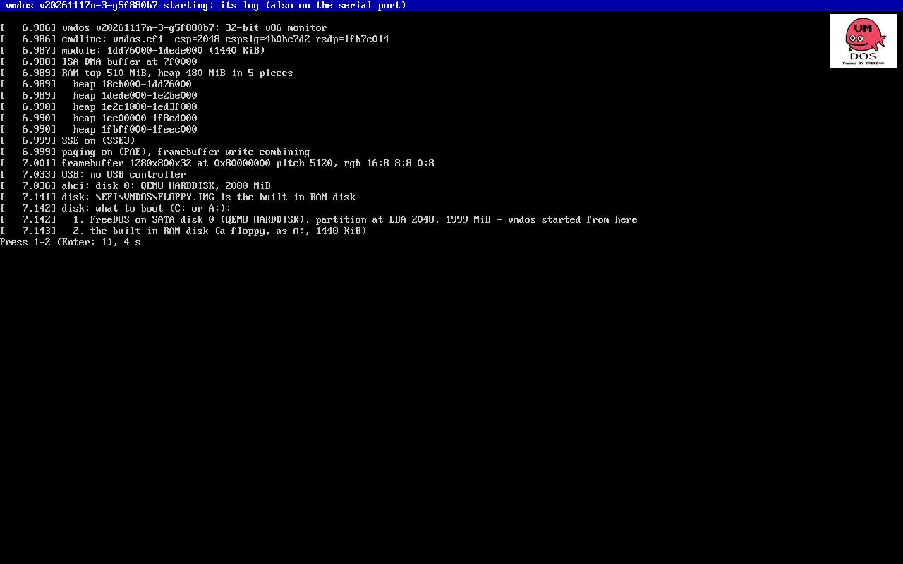<br><sub><b>Boot.</b> vmdos finds the hardware, then asks which DOS to start.</sub></td>
<td width="50%">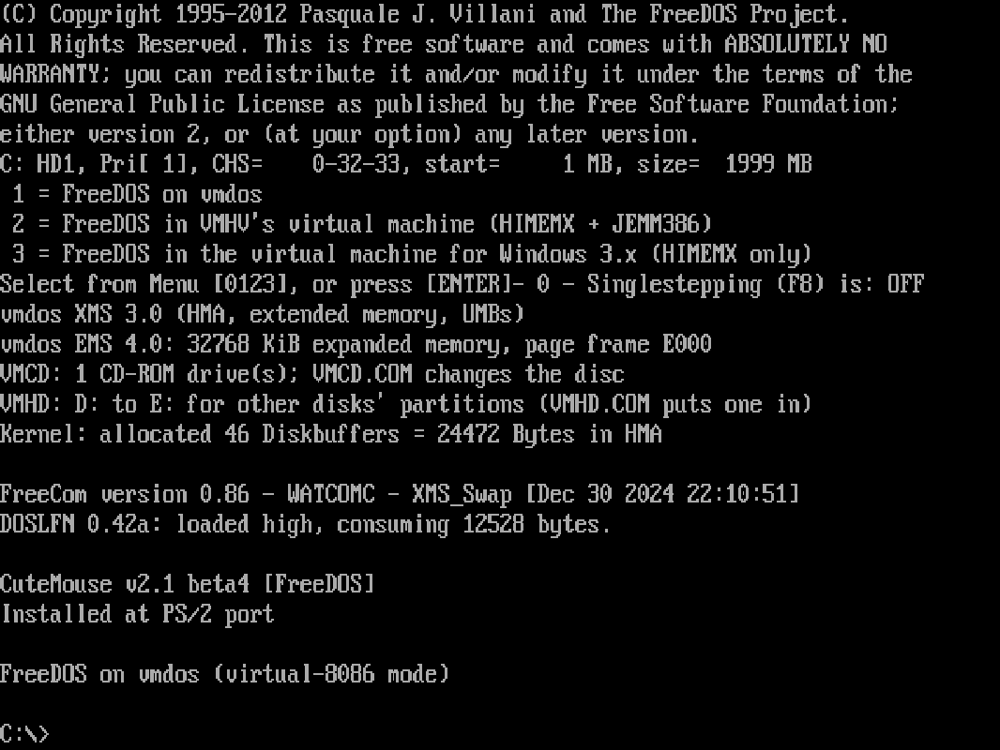<br><sub><b>C:\&gt;</b> FreeDOS with XMS, EMS, CD-ROM and mouse, all provided by vmdos.</sub></td>
</tr>
<tr>
<td>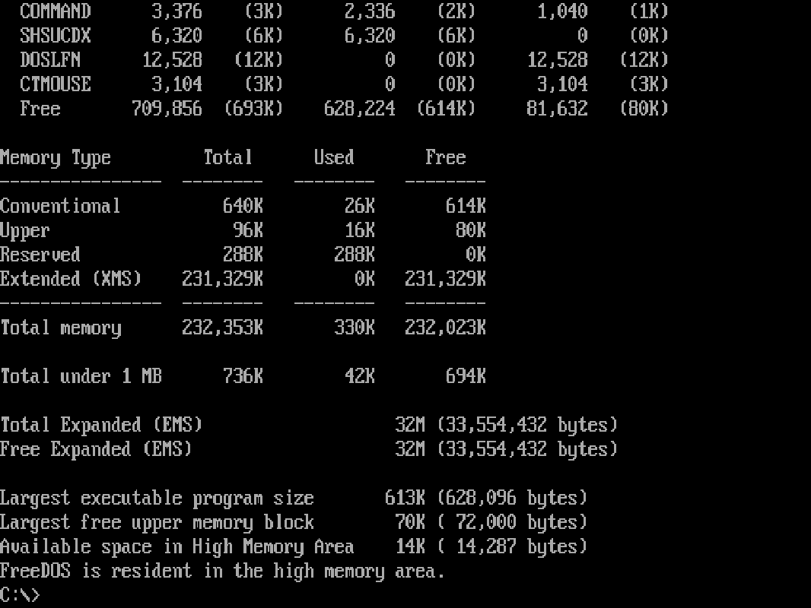<br><sub><b>MEM.</b> 614 KB free conventional memory, 32 MB EMS and plenty of XMS, with no HIMEM or EMM386.</sub></td>
<td>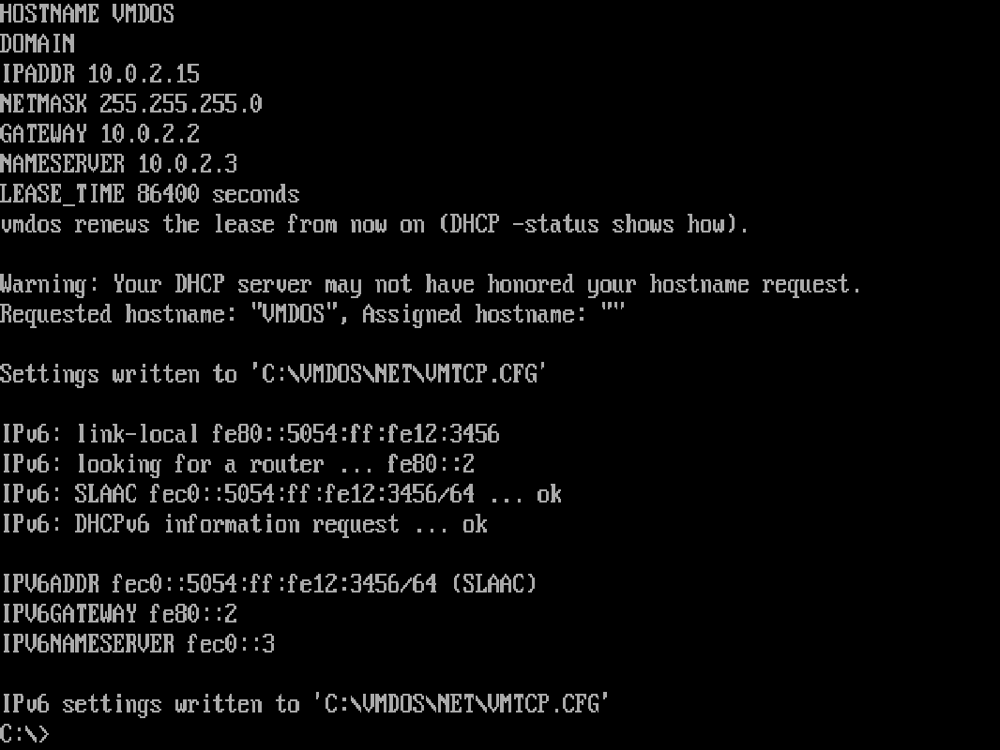<br><sub><b>STARTNET.</b> DHCP, then IPv6 SLAAC and DHCPv6, on the PC's own network card.</sub></td>
</tr>
<tr>
<td>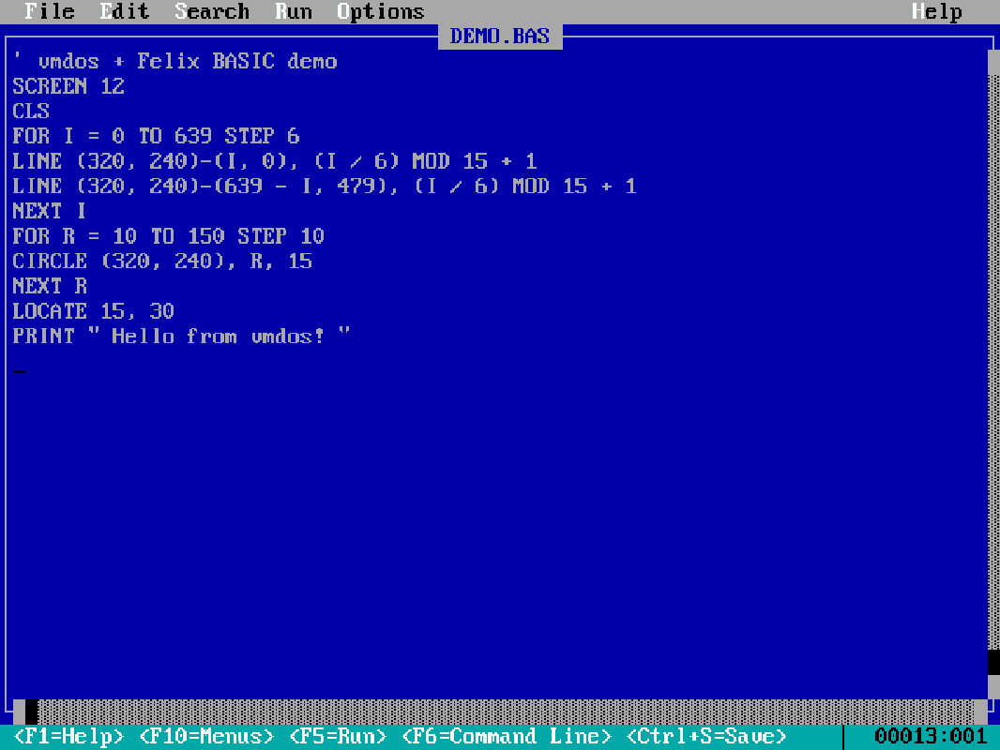<br><sub><b>Felix BASIC.</b> A QBasic-style IDE, ready to go. Press F5…</sub></td>
<td>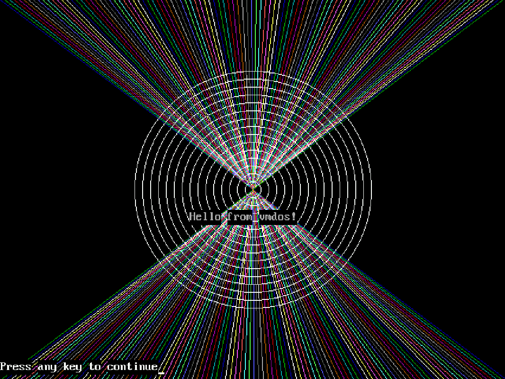<br><sub>…and you get SCREEN 12 graphics.</sub></td>
</tr>
<tr>
<td>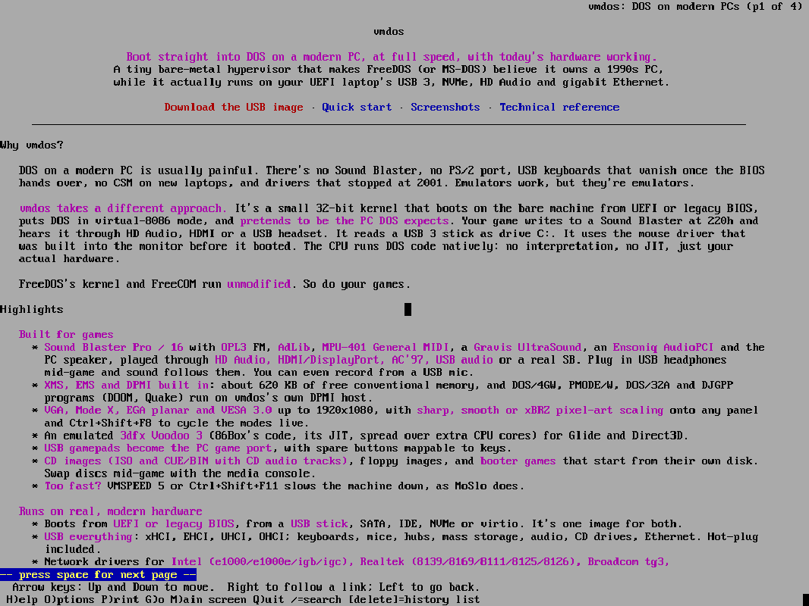<br><sub><b>Lynx.</b> A real web browser with TLS 1.3, here reading this very README in a 128x48 text mode.</sub></td>
<td>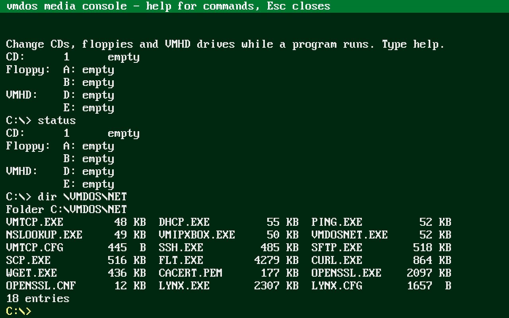<br><sub><b>Media console</b> (<code>Ctrl+Shift+F6</code>). Swap CDs, floppies and disks without leaving the game.</sub></td>
</tr>
<tr>
<td>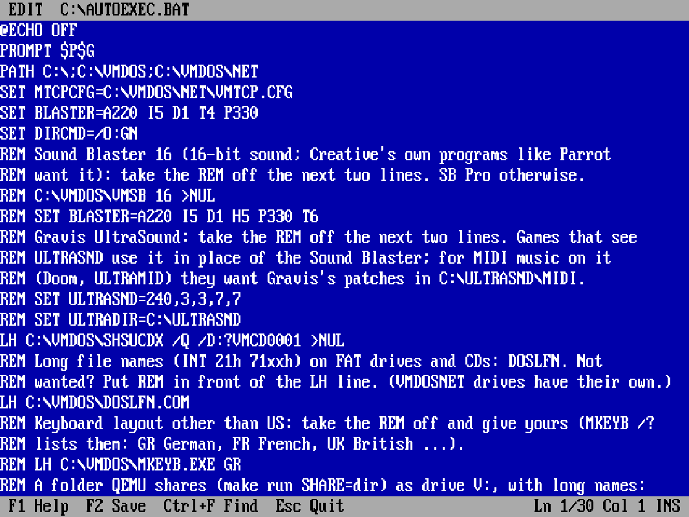<br><sub><b>EDIT.</b> vmdos's own text editor, long file names included.</sub></td>
<td><br><sub><b>FLT.</b> <code>timg</code> and <code>img2sixel</code> output on a DOS screen.</sub></td>
</tr>
</table>

## Quick start

### On a real PC (USB stick)

1. Grab **`vmdos-usb.img.xz`** from the [releases](https://github.com/jasonbrianhall/vmdos/releases).
   It's FreeDOS plus vmdos and every tool above on a 2000 MiB C:. For an actual 486, use `vmdos-usb-486.img.xz`.
2. Write it to a stick. This erases the stick:
   ```sh
   xz -dc vmdos-usb.img.xz | sudo dd of=/dev/sdX bs=4M conv=fsync
   ```
   On Windows or macOS, Etcher or Rufus works too.
3. Turn **Secure Boot off**, pick the stick in the boot menu (UEFI or legacy), and you're at `C:\>`.

The stick *is* drive C:, so saved games persist. Mount it on Linux (it's FAT32) to drop your games in.

### In QEMU

```sh
xz -dk vmdos-usb.img.xz
qemu-system-x86_64 -M q35 -accel kvm -smp 2 -m 512 -bios /usr/share/ovmf/OVMF.fd \
    -drive file=vmdos-usb.img,format=raw -nic user,model=e1000 \
    -device intel-hda -device hda-duplex
```

(Fedora's OVMF is `/usr/share/edk2/ovmf/OVMF_CODE.fd`. Drop `-bios ...` to boot through SeaBIOS instead.)

### Build it yourself

```sh
sudo apt install build-essential gcc-multilib nasm python3 mtools dosfstools gnu-efi \
                 grub-pc-bin grub-efi-amd64-bin grub-common xorriso qemu-system-x86 ovmf
make esp FRESH=1 EXTRA=games ISO="war2.iso"   # esp.img: bootable disk with your games and CDs
make run-efi-app                              # try it in QEMU (UEFI)
sudo dd if=esp.img of=/dev/sdX bs=4M conv=fsync
```

Fedora packages, `make iso`, `make efi`, chainloading from your existing GRUB and many
more options are in [TECHNICAL.md → Build and run](TECHNICAL.md#build-and-run).

## Handy keys

| Keys | What it does |
|---|---|
| `Ctrl+Shift+F6` | Media console: change CDs, floppies and disks while a program runs; `reboot` restarts DOS in half a second without resetting the PC (`REBOOT /S` from DOS) |
| `Ctrl+Shift+F8` | Cycle scaling: sharp, smooth, xBRZ, widescreen, none |
| `Ctrl+Shift+F9` | Screenshot (save it afterwards with `VMSHOT`) |
| `Ctrl+Shift+F10` | Show vmdos's log over the game (`Ctrl+Shift+S` saves it) |
| `Ctrl+Shift+F11` / `F12` | Slower / faster CPU, for speed-sensitive games |
| `Ctrl+Shift+F2` / `F3` / `F4` / `F5` | Next sound output / volume down / up / mute |
| `Ctrl+Shift+C` / `V` | Copy screen text / paste (shared with the host clipboard under QEMU) |
| `Ctrl+Shift+PgUp` | Scrollback, or just use the mouse wheel |

Everything is also on the disk as `C:\README.TXT`.

## Learn more

[**TECHNICAL.md**](TECHNICAL.md) is the full reference. It covers every boot option, how C: is
chosen, video and scaling, VBE passthrough, the Voodoo 3, serial ports, sound devices, the
network stack, VMHV, Hyper-V and a map of the source tree. Some good places to start:

- [Booting from a USB stick](TECHNICAL.md#booting-from-a-usb-stick) and [the boot menu](TECHNICAL.md#boot-menu-uefi-and-legacy-bios)
- [Drive C: and other disks](TECHNICAL.md#drive-c)
- [What works](TECHNICAL.md#what-works): BIOS, USB, memory, graphics, sound
- [Networking](TECHNICAL.md#network-packet-driver-and-ipx), [SSH](TECHNICAL.md#ssh-sftp-and-scp), [FLT](TECHNICAL.md#flt-felix-terminal-ssh-with-sixel-and-kitty-graphics), [Lynx](TECHNICAL.md#web-browsing-lynx-and-openssl), [host folders](TECHNICAL.md#host-folders-vmdosnet-9p-qemus-virtio-9p-or-a-server-on-the-network)
- [VMHV](TECHNICAL.md#vmhv-dos-in-a-virtual-machine-draft-amd-v-or-intel-vt-x) and [Hyper-V](TECHNICAL.md#hyper-v)
- [Source layout](TECHNICAL.md#layout)

## License

GPL-2.0-or-later (it includes FreeDOS's boot sector). Bundled third-party tools keep their own
licenses; each `third_party/*/README.vmdos` says where it came from.
